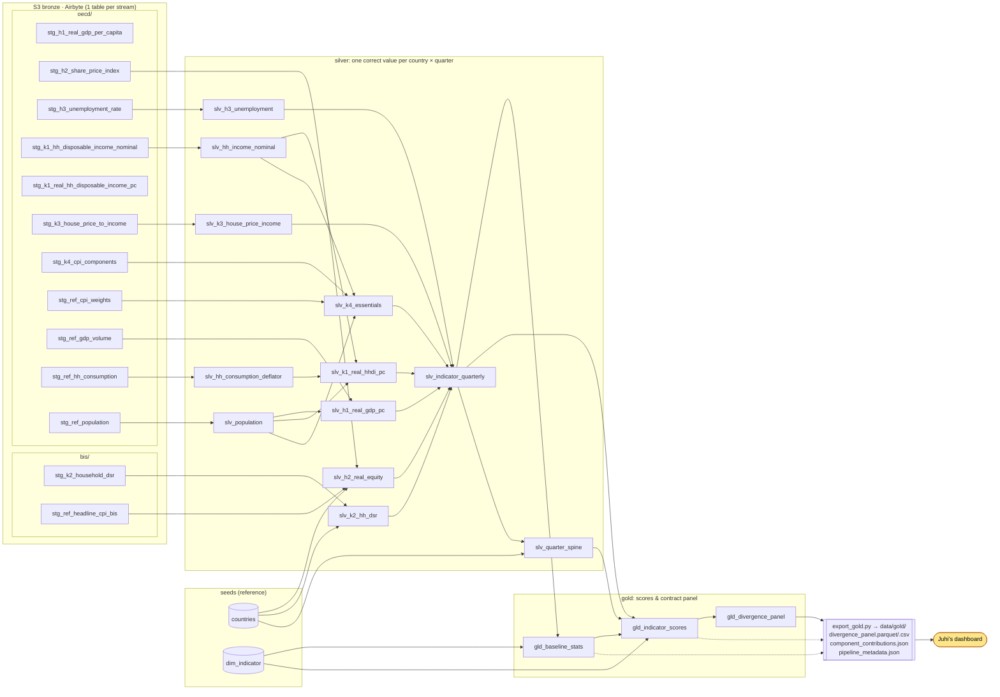
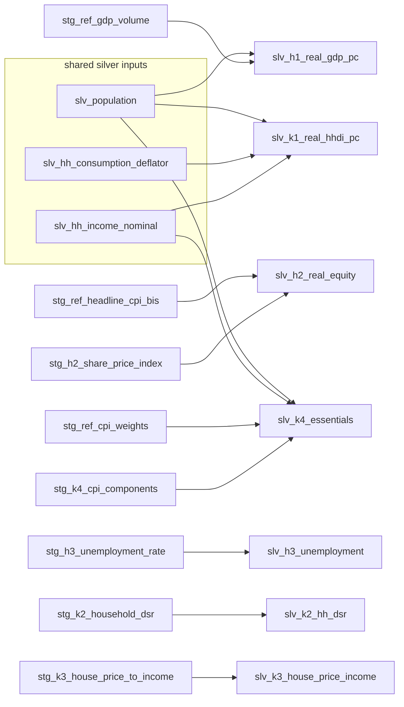
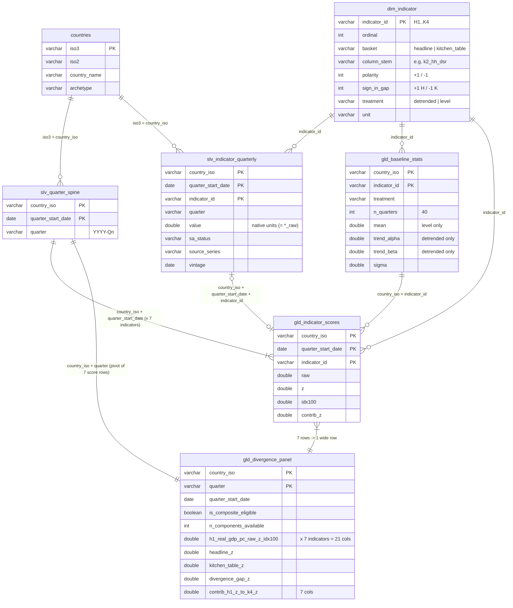

# Data model: lineage & ERD

How the tables connect, from Airbyte's raw files in S3 to the gold panel Juhi's dashboard reads.
The lineage below is **generated from dbt's own dependency graph** (`target/manifest.json`), so it matches the code.
For the interactive version (click any model to see its SQL, columns and tests):

```bash
uv run dbt docs generate --project-dir pipeline/transform --profiles-dir pipeline/transform
uv run dbt docs serve --project-dir pipeline/transform --profiles-dir pipeline/transform   # opens http://localhost:8080
```

## 1. Lineage (model-level)

Read left to right. Each staging box also stands for its bronze table in S3
(`s3://…/airbyte/<bis|oecd>/<stream>/`). That step is always one-to-one, so it's folded in.



## 2. Which inputs build each indicator (silver detail)



| Indicator | Built from | Key rule |
| --- | --- | --- |
| H1 real GDP per capita | GDP chain-linked volume (T0102, SA) ÷ population | Same population series as K1 and K4 (D4) |
| H2 real equity | quarterly avg. share index ÷ quarterly avg. BIS headline CPI × 100 | Complete quarters only (3 months) |
| H3 unemployment | quarterly avg. of monthly rate | Complete quarters only |
| K1 real household income per capita | nominal income ÷ household consumption deflator ÷ population | Built the same way for all 7 (KOR not in OECD dashboard) |
| K2 debt service ratio | BIS as published | NSA |
| K3 house price-to-income | OECD index as published | SA |
| K4 essentials burden | food & energy CPI (fixed 2015–19 weights) ÷ nominal income per capita | `var('k4_definition')` switches to price level |

## 3. Entity-relationship diagram (silver & gold)

`PK` marks the columns that together identify a row. Every grain is enforced by a dbt uniqueness test.



## 4. Grain of every layer

| Layer | Table(s) | One row per… | Shape |
| --- | --- | --- | --- |
| Bronze (S3) | 13 Airbyte streams | source observation × sync | as published, all syncs kept |
| Staging | `stg_*` (13) | source series × period, **latest sync only** | typed, labelled |
| Silver | `slv_<indicator>` (7) + 3 shared inputs | country × quarter | one clean value |
| Silver | `slv_indicator_quarterly` | country × quarter × indicator | **long** fact |
| Silver | `slv_quarter_spine` | country × quarter, 2010-Q1 → latest | balanced skeleton |
| Gold | `gld_baseline_stats` | country × indicator | 2010–19 μ/σ or trend α/β/σₑ |
| Gold | `gld_indicator_scores` | country × quarter × indicator | long: raw, z, idx100, contribution |
| Gold | `gld_divergence_panel` | country × quarter | **wide** One Big Table (38 cols, contract order) |

**Modeling techniques:** medallion layers; config-driven dimensions (`dim_indicator` drives polarity, weights and treatment);
a tidy long fact so the scoring maths is written once; a date spine for a balanced panel; and a wide One Big Table at the end
for the dashboard.
